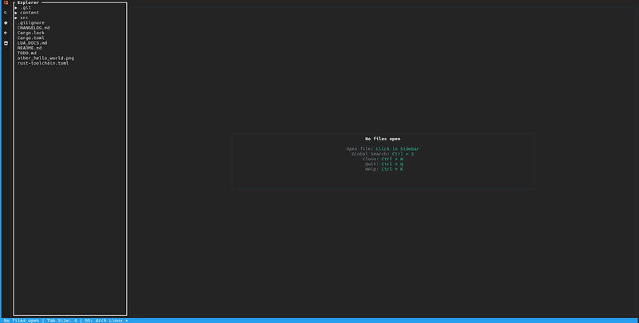

<p align="center">
  
</p>

<h4 align="center">Sprig is a highly customizable TUI text editor written in Rust.</h4>

<p align="center">
  <a>
    
  </a>
  <a href="https://codeberg.org/NamelessPopsicle/Sprig/issues">
    
  </a>
  <a href="https://codeberg.org/NamelessPopsicle/Sprig/issues?state=closed">
    
  </a>
  <a href="https://codeberg.org/NamelessPopsicle/Sprig/commits">
    
  </a>
  <a href="https://codeberg.org/NamelessPopsicle/Sprig/actions">
    
  </a>
</p>

<p align="center">
  <a href="#usage">Usage</a> •
  <a href="#requirements">Requirements</a> •
  <a href="#installing">Installing</a> •
  <a href="#support">Support</a>
</p>

<p align="center">
  
</p>

<!-- This is used to prevent a grouping bar between the gif and Usage -->
<br>

## Usage
```
Usage: sprig [OPTIONS]
    Edit text via a TUI editor.

Options:
--help, -h       Prints the Usage of Sprig
--version, -v    Prints the current version of Sprig
--admin, -a      Runs Sprig as admin
--wait, -w       Waits for you to press enter
--question, -q   Asks if you want to continue or not
```

# Installing
> There is currently no way to install Sprig.<br>
> That is still being worked on.

# Support
### OS
`Windows` • `Linux` •`MacOS` • `FreeBSD`<!-- • `OpenBSD`-->

### Arch
`x86_64` • `x86`

## How to contribute
To contribute, head to [here](https://codeberg.org/NamelessPopsicle/Sprig/issues), and make a report.<br>
Or, fork Sprig, make changes, then push them.
