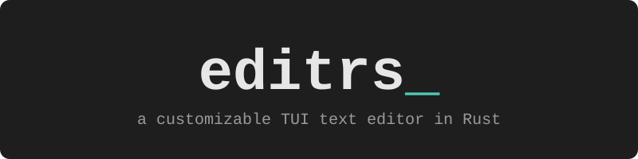

<p align="center">
  
</p>

<p align="center"><b>Um editor de texto TUI altamente personalizável, escrito em Rust.</b></p>

<p align="center">
  <a href="https://github.com/joaopssx/editrs/actions/workflows/ci.yml"></a>
  
  <a href="LICENSE"></a>
  <a href="https://github.com/joaopssx/editrs/commits/main"></a>
  <a href="https://github.com/joaopssx/editrs/issues"></a>
</p>

<p align="center"><a href="README.md">English</a> | Português (Brasil)</p>

<!-- TODO: adicionar captura de tela -->

## Funcionalidades

- Edição em abas com realce de sintaxe (via `syntect`)
- Barra lateral com explorador de arquivos, busca no projeto, status do Git com diffs, configurações e uma tela de marketplace de plugins
- Buscar e substituir no arquivo atual
- Terminal embutido (Ctrl+T ou F5)
- Paleta de comandos (Ctrl+P), desfazer e refazer, copiar, recortar e colar pela área de transferência do sistema
- Plugins em Lua 5.5, com console de depuração para a saída deles (Ctrl+E ou F12); veja os limites atuais em LUA_DOCS.md
- Textos da interface em 15 idiomas (algumas traduções estão incompletas)

O marketplace de plugins ainda não tem servidor, então a tela dele mostra uma mensagem de "indisponível".

## Uso

```
Usage: editrs [OPTIONS] [PATH]
```

`PATH` pode ser um arquivo ou uma pasta. Sem ele, o editrs abre a pasta atual. O texto completo de ajuda (em inglês) é o que `editrs --help` mostra; ele está na seção "Usage" do [README.md](README.md).

| Opção | O que faz hoje |
|---|---|
| `--help`, `-h` | Mostra a ajuda e sai |
| `--version` | Mostra `editrs <versão> by <autor>` e sai |
| `-v` | Mostra a mesma linha, mas depois continua e abre o editor |
| `--admin`, `-a` | Abre uma nova cópia do editrs com permissão de administrador (UAC via PowerShell no Windows, `sudo` ou `pkexec` nos outros) e sai |
| `--wait`, `-w` | Espera você apertar Enter e continua |
| `--question`, `-q` | Pergunta `Continue? [Y/n]`; qualquer resposta diferente de vazio, `y` ou `yes` encerra |
| `--license=all` | Mostra a licença da fonte 0xProto Nerd Font embutida e sai (`--license=ofl` mostra e continua) |

`--help`, `--version`, `--admin` e suas formas curtas só podem aparecer uma vez.

### Teclas principais

| Teclas | Ação |
|---|---|
| F1 / Ctrl+K | Ajuda |
| F2 / Ctrl+F | Buscar |
| F3 / Ctrl+R | Substituir |
| F4 / Ctrl+B | Mostrar/ocultar barra lateral |
| F5 / Ctrl+T | Mostrar/ocultar terminal |
| F6, F7 / Ctrl+A, Ctrl+D | Aba anterior / próxima |
| Ctrl+N | Novo arquivo |
| Ctrl+S | Salvar |
| Ctrl+W | Fechar aba |
| Ctrl+Q | Sair |
| Ctrl+G | Atualizar a tela do Git |
| Ctrl+P | Paleta de comandos |
| Ctrl+Z / Ctrl+Y | Desfazer / refazer |
| F12 / Ctrl+E | Console de depuração dos plugins |
| Esc | Alterna o foco entre editor e barra lateral |

Os ícones precisam de uma [Nerd Font](https://www.nerdfonts.com/) no terminal.

## Compilando a partir do código

Requisitos: Rust **1.96 ou mais novo** (algumas dependências exigem), Git e um compilador C (o Lua é compilado junto). O primeiro build baixa a fonte 0xProto Nerd Font do GitHub, então precisa de internet.

```sh
git clone https://github.com/joaopssx/editrs.git
cd editrs
cargo build --release
./target/release/editrs
```

O binário fica em `target/release/editrs` (`editrs.exe` no Windows).

### Nix

Existe um `flake.nix` (`nix build`, `nix run`), mas ele **não foi validado**. O script de build baixa uma fonte, o que a sandbox do Nix não permite, então provavelmente vai precisar de ajustes.

## Plataformas

| Plataforma | Situação |
|---|---|
| Windows x86_64 | Compila e roda (testado) |
| Linux x86_64 | Compila e passa nos testes (CI, WSL) |
| macOS | Compila no CI; não testado à mão; sem detecção de Caps Lock |
| FreeBSD | Não testado; sem detecção de Caps Lock |

## Configuração

O editrs guarda seus dados em:

- Windows: `%APPDATA%\editrs\`
- Outros sistemas: `$XDG_CONFIG_HOME/editrs/`, ou `~/.config/editrs/` quando `XDG_CONFIG_HOME` não está definida

Na primeira execução ele cria ali o `config.jsonc` e a pasta `plugins/`. Hoje só a primeira linha do `config.jsonc` é lida: uma linha `#!` que escolhe o idioma da interface. O resto usa os padrões internos.

```jsonc
#!español
```

Valores aceitos: `English`, `British English`, `한국어`, `日本語`, `简体中文`, `繁體中文`, `français canadien`, `france française`, `polska`, `deutsch`, `nederlands`, `español`, `русский`, `украинский`, `lol cat`. Qualquer outro valor volta para inglês. (Português ainda não está entre os idiomas; está no [ROADMAP.md](ROADMAP.md).)

Os plugins estão descritos em [LUA_DOCS.md](LUA_DOCS.md) (em inglês).

## Contribuindo

Veja [CONTRIBUTING.md](CONTRIBUTING.md).

## Autor

João Pedro de Sena Santana (JP, DoctorXD), [@joaopssx](https://github.com/joaopssx).

## Licença

BSD 2-Clause. Veja [LICENSE](LICENSE).
